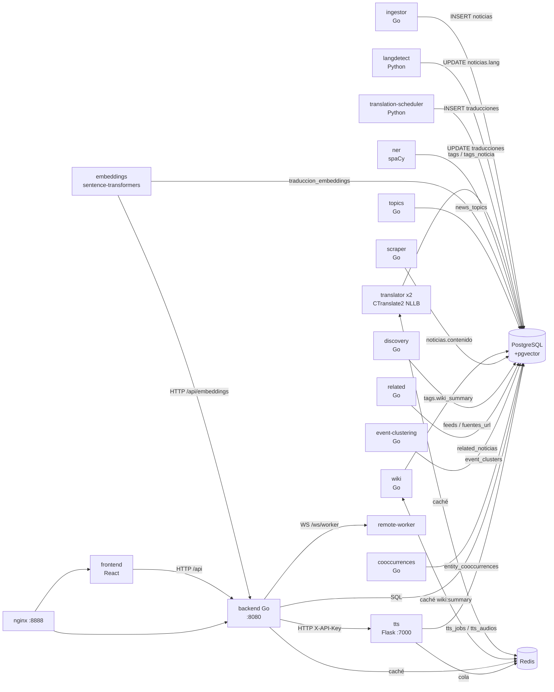

# RSS2 — Arquitectura Técnica

> Documento de referencia técnica. Verificado contra el código el **2026-10-26**.
> Fuentes: `[CÓDIGO]` = lectura directa de ficheros; `[DB]` = consulta a la base de datos en producción;
> `[DOC]` = documentación preexistente (`AGENTS.md`, `README.md`, `docs/TTS.md`, `specs/`).

---

## 1. Vista general

RSS2 es un **pipeline deeltroque de datos** con una API de lectura encima. El corpus se ingestiona,
se enriquece de forma asíncrona y se sirve desde PostgreSQL + pgvector. El único puerto público es
el `8888` (nginx) `[CÓDIGO: nginx.conf:52-54]`.

```
                          ┌──────────────────── Internet ────────────────────┐
                          │  RSS/Atom  ·  HTML  ·  Wikipedia REST  ·  WebSocket │
                          └───────────┬───────────────────────────┬──────────┘
                                      │                           │
              ┌───────────────────────▼──────┐        ┌───────────▼───────────┐
              │  ingestor (Go)               │        │  remote-worker (Py)   │
              │  rss-ingestor-go              │        │  WebSocket NLLB       │
              │  28.250 feeds / 60 min       │        │  (fuera de este host)  │
              └───────────┬──────────────────┘        └───────────┬───────────┘
                          │ INSERT                              │ UPDATE traducciones
                          ▼                                    ▼
        ┌──────────────────────────────────────────────────────────────────────┐
        │                    PostgreSQL 16 + pgvector  (fuente de verdad)      │
        │  noticias · traducciones · tags · tags_noticia · traduccion_embeddings │
        │  feeds · alertas · event_clusters · tts_* · entity_* …                │
        └───┬──────────────┬───────────────┬──────────────┬───────────────┬───┘
            │              │               │              │               │
   ┌────────▼──────┐ ┌─────▼───────┐ ┌─────▼────────┐ ┌───▼──────────┐ ┌──▼───────────┐
   │ langdetect    │ │ scheduler   │ │ translator×2 │ │ ner (spaCy)  │ │ embeddings   │
   │ (Python)      │ │ (Python)    │ │ (CTranslate2)│ │ (Python)     │ │ (Python)     │
   └───────────────┘ └─────────────┘ └──────────────┘ └──────────────┘ └──────────────┘
            │              │               │               │               │
            │              │               ▼               │               ▼
            │              │        ┌─────────────┐        │        pgvector HNSW
            │              │        │ translator  │        │               │
            │              │        │ (2º host)  │        │               ▼
            │              │        └─────────────┘        │        related / event-clustering
            ▼              ▼                              ▼               │
     ┌──────────────────────────────────────────────────────────────────────┐
     │  Workers Go (misma imagen backend): topics · wiki · scraper ·       │
     │  discovery · related · event-clustering · cooccurrences              │
     └──────────────────────────────┬───────────────────────────────────────┘
                                    │  + backend Go :8080 (API, scanner alertas, WS)
                                    ▼
                          ┌───────────────────┐
                          │  tts (Flask :7000)│  ← servicio interno, sin puertos
                          │  Chatterbox/Melo/ │     publica
                          │  OpenVoice        │
                          └─────────┬─────────┘
                                    │ WAV en ./data/tts_audio
                                    ▼
        ┌───────────────────────────────────────────────────────────────┐
        │  frontend (React SPA)  ←→  backend (:8080)  ←→  nginx (:8888) │
        └───────────────────────────────────────────────────────────────┘
```

---

## 2. Topología de contenedores

### 2.1 Red y exposición

- **Red `backend`** (bridge, `rss2_backend`): todos los servicios de datos y el backend Go.
- **Red `frontend`** (bridge, `rss2_frontend`): nginx gateway y el contenedor `frontend`.
- **Puertos publicados** (sólo dos):
  - `8888:80` → `nginx` (gateway público único) `[CÓDIGO: docker-compose.yml:816-841]`
  - `8080:8080` → `backend` — *"for remote workers WebSocket connection"* `[CÓDIGO: docker-compose.yml:771]`
  - `6000:6000` → `embeddings` — **expuesto a la red del host** `[CÓDIGO: docker-compose.yml:487-488]`
- **Sin puertos**: `db`, `redis`, `tts`, `translator*`, `ingestor`, `ner`, `scheduler`, `langdetect`,
  `wiki`, `topics`, `related`, `event-clustering`, `scraper`, `discovery`, `cooccurrences`.
- **Sin red `monitoring` declarada** en `docker-compose.yml`, pero `docker-compose.local.yml`
  referencia `networks: [monitoring, frontend]` → ese override está **roto**. `[CÓDIGO]`

### 2.2 nginx (gateway)

`nginx.conf` — un solo `server` que escucha en `:80` (publicado como 8888):

| Ubicación | Comportamiento | Nota |
|---|---|---|
| `/api/` | `proxy_pass http://$api_upstream$request_uri` | **Variable** + `resolver 127.0.0.11` — obligatorio: un `upstream` estático se resuelve una vez al arrancar y conserva la IP vieja si el contenedor del backend se recrea (síntoma: 404 de un servicio ajeno). `$request_uri` es obligatorio con variables. |
| `/` | `proxy_pass http://$frontend_upstream` | SPA |
| `/health` | `return 200 "ok"` | `access_log off` |
| `~ /\.` | `deny all` | bloquea dotfiles |

Sin `auth_request` (la autenticación es JWT en Go) y **sin `limit_req`** (el rate limit es de la
aplicación). `[CÓDIGO: nginx.conf:36-104]`

> El `frontend` tiene su propio `nginx.conf` con `proxy_pass http://backend:8080` **estático** —
> el mismo anti-patrón, pero es código muerto en esta topología (nada alcanza `rss2_frontend:80`
> directamente). `[CÓDIGO: frontend/nginx.conf:37]`

### 2.3 Servicios y límites de recursos

| Servicio | Imagen / build | Límites (CPU/mem) | Healthcheck | Notas |
|---|---|---|---|---|
| `db` | `pgvector/pgvector:pg16` | 4 / 4G | `pg_isready` | `shm_size: 256m`, `max_connections=200`, `shared_buffers=1GB`, `wal_level=replica` |
| `redis` | `redis:7-alpine` | — | `redis-cli ping` | `--appendonly yes --maxmemory 512mb --maxmemory-policy allkeys-lru --requirepass` |
| `backend` | `backend/Dockerfile` | 4 / 512M | `wget /health` | 10 binarios en la imagen |
| `frontend` | `frontend/Dockerfile` | — | `wget /` | nginx estático |
| `nginx` | `nginx:alpine` | — | `wget /` | `:8888` |
| `ingestor` | `rss-ingestor-go/Dockerfile` | 2 / 512M | grep cmdline | 20 workers HTTP |
| `translator`, `translator-2` | `translator/Dockerfile.cpu` | 2 / 3G | grep cmdline | `MAX_SEQ_PER_CALL=8`, int8 |
| `translator-gpu` | `translator/Dockerfile.gpu` | perfil `gpu` | — | `float16`/cuda, reservas GPU |
| `translation-scheduler` | `Dockerfile.scheduler` | 1 / 256M | grep cmdline | imagen `rss2-pyworkers` |
| `langdetect` | `Dockerfile.scheduler` | 1 / 256M | grep cmdline | mismo binario, otro `command` |
| `ner` | `Dockerfile.ner` | 2 / 2G | grep cmdline | `start_period: 180s` (carga spaCy) |
| `embeddings` | `Dockerfile.embeddings` | 2 / 2G | grep cmdline | `start_period: 300s` |
| `tts` | `Dockerfile.tts` | 3 / **8G** | grep cmdline | `start_period: 600s` (carga Chatterbox: 91 s) |
| `wiki` | `rss2-backend` | 1 / 512M | grep cmdline | `/wiki-worker` |
| `topics` | `rss2-backend` | 2 / 512M | grep cmdline | `/topics` |
| `related` | `rss2-backend` | 2 / 1G | grep cmdline | `/related` |
| `event-clustering` | `rss2-backend` | 2 / 1G | grep cmdline | `/event_clustering` |
| `scraper` | `rss2-backend` | 2 / 512M | grep cmdline | `/scraper` |
| `discovery` | `rss2-backend` | 2 / 512M | grep cmdline | `/discovery` |
| `cooccurrences` | `rss2-backend` | 0.5 / 256M | grep cmdline | `interval: 1h` en el healthcheck |
| `prometheus`, `grafana`, `cadvisor` | upstream | — | — | perfil `monitoring`; **sin dashboards** |

Todas las réplicas `rss2-backend-run-*` que se ven en `docker ps` **no están en `docker-compose.yml`**:
se crearon con `docker run` para escalar el clustering worker. `docker compose up/down` no las
toca. `[DOC: AGENTS.md]` `[DB] docker ps`

### 2.4 Imagen `rss2-backend`: 10 binarios

`backend/Dockerfile:28-37` compila y copia: `server`, `scraper`, `discovery`, `wiki-worker`,
`topics`, `related`, `sanitize`, `entityscan`, `event_clustering`, `cooccurrences`.
`ENTRYPOINT ["/server"]`; cada worker se invoca con `entrypoint: ["/<binario>"]` en compose.

> **Trampa conocida:** los workers comparten la *misma* etiqueta de imagen. `docker compose build`
> de dos servicios contra la misma etiqueta a la vez falla con `AlreadyExists`. Construir de uno en
> uno. `[DOC: AGENTS.md]`

---

## 3. Dependencias entre componentes



**Dependencias de arranque verificadas:**

| Consumidor | Depende de | Mecanismo de espera |
|---|---|---|
| `backend` | `db` + `redis` | `depends_on: service_healthy` + `db.Connect` reintenta 30× (2 s entre intentos, 5 s de timeout por intento) `[CÓDIGO: backend/internal/db/postgres.go:39-50]` |
| `ingestor` | `db` | `depends_on: service_healthy` + ping 30×2 s `[CÓDIGO: rss-ingestor-go/main.go:184-193]` |
| `translator` | `db` | `translator-2` sí declara `depends_on`; **`translator` no** → asimetría `[CÓDIGO: docker-compose.yml:79-127]` |
| `tts` | `db` (Redis opcional) | Redis es degradable: si falla, la cola usa Postgres `[CÓDIGO: workers/tts/queue.py:27-48]` |
| `embeddings` | `db` | `depends_on: service_healthy` |
| `topics`, `related`, `event-clustering` | `db` + `backend` | `depends_on: backend: service_started` |

---

## 4. El backend Go

### 4.1 Middleware global (`backend/cmd/server/main.go:346-358`)

1. `RequestIDMiddleware()` — propaga `X-Request-ID` (o genera uno).
2. `CORSMiddleware()` — lista blanca de orígenes; **no** es `*`; `OPTIONS` → 204.
3. `LoggerMiddleware()` — zerolog con método, ruta, estado, `ClientIP()` y latencia.
4. `SetTrustedProxies(127.0.0.1, 10/8, 172.16/12, 192.168/16)` — para que `ClientIP()` respete
   `X-Forwarded-For` de nginx.
5. `RateLimitMiddleware(300/min)` — **token bucket por (IP, límite)**; los cubos de auth (10/min) y
   el general (300/min) son independientes. Se aplica al grupo `/api` **desde** la línea 383.

### 4.2 Autenticación

| Mecanismo | Dónde | Detalle |
|---|---|---|
| JWT HS256 | `middleware.AuthRequired()` | Sólo cabecera `Authorization: Bearer <token>`. **Sin cookies**, sin token por query. Expiración **24 h** hard-coded en `auth/jwt.go:29` (`config.JWTExpiration` existe pero **no se usa**). |
| Rol admin | `middleware.AdminRequired()` | Lee `claims.IsAdmin` **del JWT**; no re-consulta la BD → un admin degradado conserva privilegios hasta 24 h. |
| API key de worker | `handlers.HandleWorkerWS` | `?api_key=` o cabecera `X-API-Key`; busca en `remote_workers` con `status != 'disabled'`. `CheckOrigin` devuelve `true` siempre. |

### 4.3 Superficie de la API (resumen)

Grupos: `auth`, `news`, `feeds`, `search`, `entities`, `events`, `alerts`, `stats`, `categories`,
`countries`, `favorites`, `lists`, `saved-searches`, `admin`, `app`, `tts`. Más `/ws/worker` y
`/swagger/*any`.

Públicas: lectura de noticias, búsqueda, entidades, eventos, estadísticas, feeds (GET),
`/api/wiki-images/*`, `login`/`register`/`check-first-user`, `/health`.
Protegidas: toda mutación, alertas, favoritos, listas, búsquedas guardadas, suscripciones, y **todo
`/api/tts/*`**. Admin: todo `/api/admin/*` + 5 rutas TTS (alta/baja de voces, calidad de voz,
estado de audio, estado de boletín).

**Código muerto verificado:** `handlers.GetAdminStats` (`admin.go:342`) y
`handlers.GetModelDownloadURL` (`worker_ws.go:337`) están definidos pero **no registrados**.

### 4.4 Goroutines del servidor

Al arrancar (`main.go:594-607`):

| Goroutine | Periodo | Función |
|---|---|---|
| `StartJobAssigner()` | 5 s | Asigna 1 trabajo a cada worker remoto conectado `[CÓDIGO: worker_ws.go:278]` |
| `StartAlertScanner()` | `ALERTS_SCAN_INTERVAL_MIN` (compose: 15 min; **default en código: 60**) | Escaneo de alertas `[CÓDIGO: alerts.go:461-478]` |
| `StartStaleJobCleanup()` | 30 s | Devuelve a `pending` los trabajos `assigned` con más de 2 min `[CÓDIGO: worker_ws.go:311]` |
| `RefreshEntityStatsStartup()` | una vez, tras 5 s de retardo | Refresca `entity_stats` `[CÓDIGO: news.go:1247]` |

Timeouts del servidor: `ReadTimeout 60s`, `WriteTimeout 120s`, `IdleTimeout 180s`.

---

## 5. Pipeline de ingesta

`rss-ingestor-go/main.go` — **módulo Go separado** (`rss-ingestor-go`, go 1.25.0).

| Aspecto | Implementación |
|---|---|
| Ciclo | `time.Ticker` de `RSS_POKE_INTERVAL_MIN`; **compose fija 60 min** (el `.env` dice 15 → configuración muerta). Si el ciclo anterior sigue vivo, **se salta el tick** `[CÓDIGO: main.go:643-648]` |
| Selección de feeds | `SELECT ... FROM feeds WHERE activo = TRUE AND (fallos IS NULL OR fallos < 10) ORDER BY id` — **sin LIMIT**: materializa los 28.250 activos en RAM cada ciclo `[CÓDIGO: main.go:197-220]` |
| Concurrencia | N goroutines (20 en compose), cada una con **su propio** `gofeed.Parser`; canal `jobs` bufferizado con `len(feeds)` `[CÓDIGO: main.go:586-600]` |
| Cliente HTTP | Timeout 60 s; `MaxIdleConns=40`, `MaxIdleConnsPerHost=2`; UA `RSS2-Ingestor-Go/1.0`; **sin límite de tamaño de cuerpo** `[CÓDIGO: main.go:136-146, 407]` |
| Cortesía por host | `politeDelay(host)`: 500 ms entre peticiones al mismo host, con mutex `[CÓDIGO: main.go:94-106]` |
| Condicionales | `If-None-Match` / `If-Modified-Since` desde `feeds.last_etag`/`last_modified`; 304 → `fallos=0` |
| Rate limit | 429/503 → respeta `Retry-After` (hasta 1 h) **sin** incrementar `fallos` |
| Normalización | `normalizeURL`: sin esquema, sin `www.`, sin puerto implícito, sin barra final, sin parámetros de tracking, query ordenada `[CÓDIGO: main.go:240-274]` |
| Id | `generateID = md5(normalizeURL(url))` → 32 hex = `noticias.id VARCHAR(32)` `[CÓDIGO: main.go:276-279]` |
| Texto | `textclean.CleanTitle` / `textclean.Clean` (HTML parseado con `x/net/html`, nunca regex) |
| Inserción | Lotes de **500** filas × 11 columnas (5.500 parámetros); `ON CONFLICT DO NOTHING`; **sin `pq.CopyIn`** (evita dejar el backend en modo COPY con lock ACCESS EXCLUSIVE) `[CÓDIGO: main.go:469-543]` |
| Errores | Feed borrado en vuelo → detecta SQLSTATE **23503** y lo reporta explícitamente `[CÓDIGO: main.go:478-484, 526-537]` |
| Backoff | Ninguno exponencial. `fallos` se incrementa; a los 10 fallos el feed se desactiva (`activo=FALSE`) |
| Métricas | **Sólo logs**. No expone Prometheus |

---

## 6. Pipeline de traducción

### 6.1 `translation-scheduler` (Python)

Dos rutas para evitar el anti-join sobre todo el catálogo (que tardaba ~12 min/ciclo):

| Ruta | Columna | Ventana | Lote | Cadencia |
|---|---|---|---|---|
| **Fast** | `noticias.created_at` | `SCHEDULER_LOOKBACK_MINUTES` (60) | 2.000 | cada ciclo (30 s) |
| **Catch-up** | `noticias.updated_at` | `SCHEDULER_CATCHUP_LOOKBACK_HOURS` (168) | 20.000 | cada `SCHEDULER_CATCHUP_INTERVAL_MIN` (360) |

La ruta catch-up existe porque el trigger `update_noticias_updated_at` refresca `updated_at` en
cada UPDATE, de modo que las noticias etiquetadas por `langdetect` minutos después de insertarse
sólo son visibles por `updated_at`. `[CÓDIGO: workers/translation_scheduler.py:109-242]`

El SQL filtra: `lang` no nula/no vacía, `lang != destino`, descarta `und|unknown|mul|zxx|mis|sgn`,
exige texto no vacío, y `NOT EXISTS` una traducción previa para ese `lang_to`.
`ON CONFLICT (noticia_id, lang_to) DO NOTHING`. `[CÓDIGO: translation_scheduler.py:126-146]`

> `window_col`/`window_unit` se **interpolan** en el SQL con f-string (líneas 130, 142). Hoy es seguro
> porque los únicos llamantes pasan literales. Fragilidad a vigilar. `[CÓDIGO]`

### 6.2 `translator` (Python, CTranslate2)

- **Modelo**: NLLB-200-distilled-600M convertido a CTranslate2, `compute_type=int8`, `device=cpu`.
  El modelo vive en `./models/nllb-ct2` (600 MB) montado en solo lectura.
- **Reclamo**: `FOR UPDATE SKIP LOCKED` + `ORDER BY n.fecha DESC LIMIT 128`, filtrando
  `worker_id IS NULL` (deja fuera lo asignado a workers remotos) y liberando tras 10 min.
  `[CÓDIGO: ctranslator_worker.py:667-717]`
- **Memoria**: `MAX_SEQ_PER_CALL=8` (compose) — **obligatorio**: 8 ≈ 1,8 GiB, 32 ≈ 3,1 GiB (OOM con
  límite de 3 GB). `[DOC: AGENTS.md]`
- **Caché**: Redis `tr:{from}:{to}:{md5(texto)}`, TTL 30 días, `MGET` en pipeline. Degrada limpio.
- **Reintentos**: `retry_count < 3` → `pending`; ≥3 → `error`.
- **Confianza**: `calculate_confidence` (ratio de longitud + penalización de bigramas repetidos +
  contenido), ponderada `0,2·título + 0,4·resumen + 0,4·contenido` → `traducciones.confidence`.
- **Cortes**: cuerpos largos se trocean a 2.000 caracteres por frontera de frase.

### 6.3 Workers remotos (WebSocket)

- **Servidor**: `rss.GET("/ws/worker", handlers.HandleWorkerWS)` — **en el router raíz, fuera de
  `/api`**, por tanto sin rate limit. Ping cada 10 s, cierre si no hay heartbeat en 180 s.
- **Asignación**: el *servidor* reclama (`status='assigned'`, `worker_id`, `assigned_at`) y empuja
  `{type:"job", job:{...}}`. Máximo 1 trabajo por worker y tick de 5 s.
- **Recuperación**: `StartStaleJobCleanup` (30 s) devuelve a `pending` lo `assigned` con >2 min.
- **Protocolo cliente**: `register` → `ack`; `result` → `done`/`error`; `ping`/`pong`.
- **Estado real**: 1 worker registrado (`portatil`, `status='online'` pero `last_seen` del
  2026-10-09) y **0 traducciones** con `worker_id`. El panel de admin cuenta `status='online'` desde
  la BD → **falso positivo**. `[DB]`

---

## 7. Cadena de enriquecimiento

### 7.1 `ner` (Python / spaCy)

- Modelos: `es_core_news_lg` (es) y `en_core_web_lg` (en); `disable=["lemmatizer","textcat"]`.
- Entrada: `traducciones` con `status='done'` y `lang_to` de los modelos cargados, **anti-join** con
  `tags_noticia` → idempotente. Lote `NER_BATCH=64`.
- Salida: `tags` (`valor`, `tipo`) + `tags_noticia`; si no encuentra nada, inserta el centinela
  `_none_` con tipo `sistema` para no reprocesar.
- Tipos: `PERSON/PER→persona`, `ORG→organizacion`, `GPE/LOC→lugar`, `MISC→tema`.
- Filtros: blocklist de BD (`entity_blocklist`, refrescado cada 10 min) + `entity_config.json` +
  reglas de forma (`_looks_like_attr_or_path`, `GENERIC_BAD_TAGS`, …).
- **`preshed==3.0.13` es obligatorio** (3.0.14 rompe todos los modelos con `OverflowError`).
  `[CÓDIGO: Dockerfile.ner:8-12]` `[DOC: AGENTS.md]`

### 7.2 `embeddings` (Python / sentence-transformers)

- Modelo: `paraphrase-multilingual-MiniLM-L12-v2`, **384 dimensiones**, `DEVICE=cpu`.
- **Dos rutas de escritura**:
  1. Traducciones (`traduccion_id` NOT NULL) — anti-join con `traduccion_embeddings`.
  2. **Originales ya en español** (`traduccion_id IS NULL`, `noticia_id` NOT NULL) — migración 60.
     Sin esto la búsqueda semántica sólo devolvía traducciones.
- **Cursor** `created_at > cursor` sobre `noticias` (el id es un md5, no ordenable); sin él la consulta
  era un seq scan paralelo de 2,1 s cada 5 s.
- Expone además `GET /health` y `POST /api/embeddings` (Flask, `:6000`, **puerto publicado al host**).

### 7.3 `topics` (Go)

- Empareja título+resumen contra `topics` (tabla `weight` + `keywords` CSV) → `news_topics`.
- Infiere país con una tabla de alias **hard-coded** en el binario.
- Marca `noticias.topics_processed = TRUE`; **ordena los ids alfabéticamente antes del UPDATE masivo**
  para no hacer deadlock con `langdetect` (que ordena por id). `[CÓDIGO: cmd/topics/main.go:326-333]`

### 7.4 `wiki` (Go)

- Para cada `tags` de tipo `persona`/`organizacion` con `wiki_checked = FALSE`: REST summary de
  Wikipedia (es y luego en), fallback a la API OpenSearch; descarga la miniatura a
  `./data/wiki_images/wiki_<tagID>.jpg`.
- Backoff adaptativo: 1 s base, hasta 60 s en errores consecutivos, se reduce a mitad con éxito.
- Rechaza páginas de desambiguación. Los errores transitorios (timeout/429/503/504) **no** marcan
  `wiki_checked` → se reintentan.

### 7.5 `related` y `event-clustering` (Go)

- `related`: para cada traducción `es` con embedding, busca los k vecinos por coseno en pgvector y
  escribe `related_noticias`. Crea la función `find_related_translations(vector(384), int, float, int)`
  y un índice HNSW.
- `event-clustering`: agrupa noticias por similitud de embedding **y** ≥2 entidades compartidas;
  escribe `event_clusters` + `noticia_clusters`. `CLUSTERING_MIN_SIM=0.85`, ventana 72 h.

### 7.6 `cooccurrences` (Go)

Recalcula los pares de co-ocurrencia sobre los últimos 30 días (`HAVING COUNT(DISTINCT noticia_id) >= 3`),
con `TRUNCATE` + re-inserción. Intervalo por defecto **24 h**. Es el único worker que usa
`sqlx`+`lib/pq` en vez de pgx. `[CÓDIGO: cmd/cooccurrences/main.go:13-14, 89-105]`

---

## 8. Motor de alertas

`backend/internal/handlers/alerts.go` + `backend/internal/entitycheck/`.

### 8.1 Detector de picos

La CTE horaria agrupa por `date_trunc('hour', n.fecha)` y **excluye la hora incompleta**:

```sql
SELECT t.id AS tag_id, t.valor, t.tipo,
       date_trunc('hour', n.fecha) AS hora,
       COUNT(DISTINCT n.id) AS cnt
FROM tags_noticia tn
JOIN tags t ON tn.tag_id = t.id
JOIN traducciones tr ON tn.traduccion_id = tr.id
JOIN noticias n ON tr.noticia_id = n.id
WHERE n.fecha >= CURRENT_DATE - 30
  AND n.fecha < date_trunc('hour', CURRENT_TIMESTAMP)
  AND t.tipo IN ('persona','lugar','organizacion','tema')
GROUP BY t.id, t.valor, t.tipo, date_trunc('hour', n.fecha)
```

El **baseline es ponderado por volumen** (no la media de ratios por bucket):

```sql
SUM(h.cnt::float) / NULLIF(SUM(v.noticias),0) * r.noticias AS baseline
```

Es decir: *menciones acumuladas / noticias acumuladas de esas horas × noticias de la hora de
referencia*. El estimador correcto de "menciones esperadas en la hora de referencia". El código
antiguo (`AVG(cnt/noticias)` por bucket) dejaba que un bucket con 9 noticias y 1 mención (ratio 11 %)
dominara la media e invalidaba todos los picos → el detector devolvía siempre 0. `[CÓDIGO: alerts.go:316-340]`

### 8.2 Umbrales

| Tipo | MinHits | MinBaseline | MinRatio | MinBuckets |
|---|---|---|---|---|
| Base (persona/lugar/organizacion) | 5 | 1 | 5 | 2 |
| `tema` | 6 | 2 | 6 | 3 |

Sobrescribibles por env: `ALERTS_MIN_HITS`, `ALERTS_MIN_RATIO`, `ALERTS_MIN_BASELINE`,
`ALERTS_MIN_BASELINE_BUCKETS` y los equivalentes `ALERTS_TEMA_*`.
`ALERTS_LOOKBACK_HOURS=24`, `ALERTS_COOLDOWN_HOURS=6`.
El código añade además un filtro de falsos positivos (`entitycheck.Classify`) y la supresión por
cooldown. `[CÓDIGO: entitycheck/alertas.go:27-63]`

### 8.3 Consumo

`alertas` es **estado agregado** (`valor`, `tipo`, `periodo` únicos), no derivado por FK de
`noticias` → tras un reset del corpus hay que hacer `TRUNCATE` explícito.
`GET /api/entities/news?periodo=YYYY-MM-DD HH24:MI` filtra a `[periodo, periodo+1h)`, que es
exactamente la granularidad del detector. `[CÓDIGO: news.go:545-558]`

---

## 9. Subsistema TTS

### 9.1 Separación de responsabilidades

```
frontend/Noticiario.tsx
   │  POST /api/tts/scripts/prepare   →   Go crea tts_scripts (borrador)
   │  PUT  /api/tts/scripts/:id        →   Go guarda content (re-normaliza)
   │  POST /api/tts/bulletins          →   Go crea tts_bulletins + items (position)
   │  POST /api/tts/bulletins/:id/approve → Go crea 1 tts_job por item + LPUSH tts:queue
   ▼
backend Go  ──HTTP X-API-Key──►  tts (Flask :7000)
                                   ├─ RPOP tts:queue  (fallback: FOR UPDATE SKIP LOCKED en Postgres)
                                   ├─ sintetiza (Chatterbox / MeloTTS / OpenVoice)
                                   ├─ ./data/tts_audio/<script_id>/job-<job_id>.wav
                                   └─ concatena → bulletins/bulletin-<id>.wav
```

- **El backend Go escribe `tts_scripts`, `tts_jobs`, `tts_bulletins`, `tts_bulletin_items`.**
- **El servicio Python escribe `tts_audios`** y el `audio_path` del boletín.
- El audio **nunca** va en Postgres: sólo la ruta relativa, `duration_seconds`, `sample_rate`,
  `size_bytes` y `sha256`. `[CÓDIGO: init-db/57-add-tts.sql:10-11]`

### 9.2 Motores

| Motor | Estado | Rasgos | Limitaciones |
|---|---|---|---|
| **Chatterbox Multilingual** | **por defecto**, cargado (91 s) | 23 idiomas, salida 24 kHz PCM_16, clonación en un paso con audio de referencia, PerTh watermark | `speed` no es nativo → `librosa.time_stretch`; estadoful (el clonado muta `model.conds`); el modelo T3 `v2` **no está en disco** (sólo `v3`) |
| MeloTTS | instalado, no cargado | 256 hablantes ES, salida ~22,05 kHz | sin clonación |
| OpenVoice V2 | instalado, no cargado | conversión de timbre con embedding `.pth` o audio de referencia | **`wavmark` está stubbeado → salida sin marca de agua**; rechaza embeddings `.pth` |

Registro de motores: `workers/tts/engine.py:875-879`. Un nombre desconocido en `TTS_ENGINES` se
**descarta en silencio** (sólo se refleja como clave ausente en `/health`).

### 9.3 Voces

- Clave: `tts_voices.slug`. Por defecto `es-base`, sincronizada con `TTS_ENGINE` al arrancar.
- Semilla: `models/openvoice/voices/manifest.json` (4 demos con `.mp3` de referencia) y
  `models/openvoice/base_speakers/manifest.json` (10 voces `ov-*` con embedding `.pth`).
- Alta de voz propia: `POST /api/tts/voices` (**sólo admin**), multipart campo `sample`,
  ≤ 50 MB, extensiones `.wav .mp3 .ogg .oga .opus .flac .aif .aiff .au`.
- Control de calidad: `analyze_sample` marca `too_short` (<3 s), `too_long` (>60 s),
  `low_sample_rate` (<22050), `not_mono`, `too_quiet` (pico <0,05), `clipping` (>1 % de muestras
  ≥0,99). El resultado va a `quality_report` JSONB.
- **Gated por `TTS_ALLOW_VOICE_UPLOAD`** — en el `.env` de producción está a **1** (habilitado).
- El motor de una voz nueva sale del campo `engine` del formulario; si no, el del servicio.
- **Ningún endpoint sirve las muestras de voz**: `TTS_VOICES_DIR` no está montado en ningún servidor
  web. `[CÓDIGO: workers/tts/service.py:614-615]`

### 9.4 Sincrónico vs asíncrono

| Operation | Modo | Nota |
|---|---|---|
| `POST /api/scripts/normalize` | síncrono | El backend lo delega para que haya una sola implementación de normalización |
| `POST /api/synthesize` (servicio) | síncrono | **Reservado a pruebas/uso interno**; el wrapper Go `TTSSynthesizePreview` no está expuesto por ninguna ruta |
| `POST /api/tts/jobs` → cola | asíncrono | `tts_jobs` + `LPUSH tts:queue`; el push es *fire-and-forget* (su error se descarta) y Postgres es la fuente de verdad |
| Watchdog | asíncrono, 30 s | Deadline = `max(job_timeout, chars/16,6 × 3)`; por encima → `failed` con `timeout`; por debajo → `queued` con `stale_recovered` |

### 9.5 Duración

- **La duración real se mide**, nunca se estima: `probe_audio` → `frames/samplerate`.
- La estimación (16,6 caracteres/s) existe sólo en el frontend (`Noticiario.tsx:33`) y en el
  watchdog (`workers/tts/db.py:467-468`).

### 9.6 Extensión hacia mejor calidad de voz

Puntos de extensión ya existentes (no requieren cambiar el motor):

1. `workers/tts/engine.py` → `VoiceEngine` (ABC) + `ENGINE_CLASSES` + `build_engines` +
   `resolve_engine`. **Añadir un motor = una clase nueva + una entrada en el registro.**
2. `workers/tts/config.py` → `TTS_ENGINES` (lista) y `TTS_ENGINE` (por defecto).
3. `workers/tts/voices.py` → `analyze_sample` / `store_sample`: un motor nuevo que acepte
   referencia de audio reutiliza el registro de voces tal cual.
4. `workers/tts/service.py` → `_build_engine` / precarga en hilo de fondo.
5. `init-db/57-add-tts.sql` → `tts_voices.engine` + `tts_audios.engine`/`engine_version` ya
   persisten el motor usado (**no hay que tocar el esquema**).
6. `backend/internal/handlers/tts.go` → `resolveTTSEngine` (petición → voz → default global).

**Limitación real para clonación:** hoy la única voz clonable de forma natural es Chatterbox
(referencia de audio). OpenVoice requiere precomputar el embedding. **No hay ningún mecanismo de
consentimiento ni registro de autorización de la voz** — ése es el hueco a cerrar antes de
activar clonación de terceros (ver `ROADMAP.md`).

---

## 10. Frontend

- **Stack**: React 18, TypeScript, Vite 5, Tailwind 3, `@tanstack/react-query` v5, `axios`,
  `react-router-dom` v6, `lucide-react`, `date-fns`. **Sin** Redux/Zustand.
- **Base URL**: `import.meta.env.VITE_API_URL || '/api'`. Vite lo *incrusta en build*; el
  `VITE_API_URL: /api` de compose **no tiene efecto** (no hay `ARG`/`ENV` en el Dockerfile). El valor
  efectivo es el fallback `'/api'`, que es correcto. `[CÓDIGO: frontend/Dockerfile, api.ts:3]`
- **Auth**: token JWT en `localStorage['token']` + `localStorage['user']`; interceptor que añade
  `Authorization: Bearer`; interceptor de 401 que limpia la sesión y redirige a `/login?expired=1`.
- **Rutas activas**: 15 de 21 páginas. Muertas: `Home`, `LoginPage`, `OnboardingPage`,
  `SettingsPage`, `Layout`, `contexts/AppContext.tsx` (el `AppProvider` **nunca se monta**, así que
  `useApp()` lanzaría una excepción).
- **Tests**: 2 ficheros, 18 casos (`Noticiario.test.tsx` 14, `Alertas.test.tsx` 4).
  `npm test` **no se pudo ejecutar en esta auditoría**: Node.js no está instalado en la máquina.

---

## 11. Observabilidad

| Mecanismo | Estado |
|---|---|
| Logs de aplicación | `zerolog` (backend) y `logging` (Python). **Consola**, sin ficheros |
| Logs de contenedor | Ancla `x-logging`: `json-file`, `max-size: 20m`, `max-file: 3` en los 24 servicios |
| Métricas Prometheus | **No existe endpoint `/metrics`** en la aplicación |
| `prometheus.yml` | Sólo se auto-scrapea y a `cadvisor`. El target `rss2_web` está comentado |
| Dashboards Grafana | `monitoring/grafana/dashboards/json/` está **vacío** |
| Métricas de traducción | Tabla `translation_stats` (lote, ms, host) — la única instrumentación propia |
| Rate limit | `/api/stats/ratelimit` expone contadores en vivo |
| Salud de workers | Todos los workers exponen `/health` en `:8080` **interno** (no publicado) |

---

## 12. Referencias

- `DATA_FLOW.md` — recorrido de los datos y puntos de fallo.
- `DATABASE.md` — esquema, índices, consultas hot, cuellos de botella, Redis.
- `COMPONENTS.md` — inventario por fichero y responsabilidad.
- `KNOWN_ISSUES.md` — problemas confirmados con evidencia.
- `DECISIONS.md` — decisiones verificadas y recomendaciones separadas.
- `docs/TTS.md` — manual de operación del TTS (existente, no duplicado aquí).
- `AGENTS.md` — constitución del proyecto y quirks operativos (existente, autoritativo).

---

## 13. Tier frío: archivo en otra base de datos (PROPUESTA, no aplicada)

> Requisito del propietario (2026-10-26): *"necesito que el archivo de la base de datos sea otra
> base de datos que no le afecte las consultas, para aliviar la carga"*. Documentado aquí con las
> mediciones que lo justifican; **no implementado**.
>
> ⏸️ **APLAZADO el 2026-10-26** por decisión del propietario. Se conserva el diseño y las
> mediciones; no hay ninguna tarea de implementación activa. Ver `DECISIONS.md` B-16.

### 13.1 El problema medido

| Métrica | Medido hoy | Proyección a escala completa |
|---|---|---|
| Filas de `noticias` | 814.290 (2 días) | 43 M (90 días) · 174 M (1 año) |
| Coste por noticia (heap + índices + vector/HNSW) | **9,75 KB** | — |
| Tamaño total del corpus | 3,6 GB | **44 GB** (10 d) · **400 GB** (90 d) · **1,6 TB** (1 año) |
| Índice HNSW de vectores | 117 MB por 58 K vectores (~2,1 KB/vector) | **90 GB** (90 d) — debe caber en RAM |
| `SELECT COUNT(*) FROM noticias` | **635 ms** (escaneo total del índice, 83.623 buffers) | **33,5 s** (90 d) · 136 s (1 año) |
| `pg_dump` completo | 6 min 10 s → 1,1 GB | escala lineal |

La consulta que más sufre es el `COUNT(*)` que el backend ejecuta **en cada página** de
`/api/news` y `/api/search` cuando hay filtros (`handlers/news.go:356`, `handlers/search.go:394`).

### 13.2 Diseño de dos niveles

```
   ESCRITURAS                     ┌──────────────────────────────┐
   ingestor, langdetect,          │  TIER CALIENTE               │
   scheduler, translator,         │  PostgreSQL actual            │
   ner, embeddings, topics        │  · ventana de ~10 días        │
          │                      │  · recibe todas las escrituras│
          └─────────────────────►│  · índices FTS + HNSW vivos   │
                                 │  · PG64, memoria gestionable  │
                                 └───────────────┬──────────────┘
                                                 │  worker `archiver`
                                                 │  (sólo lo YA traducido
                                                 │   y con > 10 días)
                                                 ▼
                                 ┌──────────────────────────────┐
      LECTURAS                     │  TIER FRÍO                   │
      (API, un solo camino) ──────►│  OTRA base de datos Postgres │
                                 │  · histórico completo         │
                                 │  · índices propios (FTS/HNSW)│
                                 │  · otro host, otra CPU/RAM   │
                                 └──────────────────────────────┘
```

**Aislamiento**: son **instancias distintas** → el archivo no compite por CPU, RAM, I/O ni locks
con el primario. Es la respuesta literal a "que no le afecte las consultas".

### 13.3 Motor del tier frío

| Opción | Ventajas | Inconvenientes | Veredicto |
|---|---|---|---|
| **PostgreSQL (2ª instancia)** | Cero tecnología nueva; mismo SQL, driver y herramientas; `make check-schema` sigue sirviendo; `pg_dump`/`pg_restore` compatibles; **ya hay infra de replicación en el repo** (`wal_level=replica`, `replica_slot`, `init-replica/`) | Dos instancias que mantener; no es lo mejor para analítica pura | ★★★★ **Recomendada** |
| **ClickHouse** | Diseñado exactamente para este caso (append-only + analítica); compresión 10–20×; resuelve 10 años sin esfuerzo | Tecnología nueva y pesada (~2 GB de binario, 4 GB+ de RAM); **SQL distinto** → hay que reescribir cada consulta del archivo; nueva superficie operativa | ★★★★★ para analítica · ★★ para el coste de adopción |
| **Réplica física (ya prevista)** | Aísla las **lecturas** (se puede mandar el archive-search a la réplica) y no requiere código nuevo | ⚠️ **No reduce el crecimiento del primario**: una réplica física espeja todo, no puede "quedarse sin" filas. Y el WAL completo duplica el coste de escritura | ★★★ solo para descargar lecturas |
| **SQLite / DuckDB sobre ficheros** | Un solo fichero, sin servidor | ⚠️ El propietario descarta explícitamente los ficheros; DuckDB sobre Parquet es "otro formato de fichero" | Descartado por requisito |

### 13.4 Federación: una sola consulta a través de la frontera

`postgres_fdw` está **disponible y cargable** en la imagen (`/usr/share/postgresql/16/extension/postgres_fdw*`; `pg_available_extensions` lo lista, no instalado):

```sql
CREATE EXTENSION postgres_fdw;
CREATE SERVER archive FOREIGN DATA WRAPPER postgres_fdw
  OPTIONS (host 'archivo-db', dbname 'rss_archive', user 'rss');
CREATE FOREIGN TABLE noticias_archive (id varchar(32), titulo text, ...)
  SERVER archive OPTIONS (schema_name 'public', table_name 'noticias');
```

El backend seguiría haciendo **una sola consulta** con `UNION` entre la tabla local y la foránea,
y el filtro de fecha se empuja al servidor remoto. **No hay que duplicar el código de búsqueda.**
⚠️ A validar en un PoC: que el planner empuje el filtro de fecha y que el `COUNT(*)` combined
no serialice las dos consultas.

### 13.5 La regla de archivado (imprescindible)

⚠️ **Conflicto con la decisión "se traduce todo" (A-26).** Si el tier caliente corta a los 10 días
y la traducción de la cola antigua tarda ~70 días (W7.5), **la noticia se archivaría sin traducir**
→ "se traduce todo" sería falso.

**Regla propuesta**: el archivador mueve una noticia al tier frío **sólo cuando**:
1. tiene más de la ventana (10 días), **y**
2. ya está traducida (`traducciones.status='done'`), **o** su idioma es el destino, **o** está
   marcada explícitamente como no traducible.

Las noticias antiguas **sin traducir siguen en el tier caliente** hasta que se traduzcan.
Así los dos objetivos son compatibles: el histórico se retira del camino caliente **ya
traducido**, y nada se archiva antes de tiempo.

### 13.6 Qué falta decidir

| # | Pregunta |
|---|---|
| P-11 | ¿Ventana del tier caliente: 10 días, 30 días? (10 días es agresivo para el backlog de traducción) |
| P-12 | ¿Motor del tier frío: Postgres (recomendado) o ClickHouse? |
| P-13 | ¿El histórico **antiguo** (p. ej. > 1 año) se descarta o se congela en un tiers aún más frío? |
| P-14 | ¿El tier frío es consultable por el usuario final (búsqueda unificada) o sólo por la API interna/analítica? |

### 13.7 Lo que hay que construir (orden)

1. **PoC de medición** (1 día): una 2ª instancia Postgres con `postgres_fdw` apuntando a ella, y
   medir si el `UNION` con filtro de fecha mantiene la latencia de `/api/search`.
2. **Worker `cmd/archiver`** (2–3 días): mover en lotes (`FOR UPDATE SKIP LOCKED` sobre las
   noticias candidatas), respecting la regla 13.5, con reintentos e idempotencia
   (`ON CONFLICT` por id en el destino).
3. **Enrutado de consultas** (1–2 días): decidir por rango de fechas si la consulta va al caliente,
   al frío o a ambos (`UNION` vía FDW).
4. **Métricas** (W1): tamaño de ambos niveles, filas movidas/día, latencia de las consultas
   federadas.

---

## Referencias

- `DATA_FLOW.md` — recorrido de los datos etapa por etapa, qué pasa si cada etapa falla.
- `DATABASE.md` — esquema, índices, consultas hot, volumen, cuellos de botella, Redis.
- `COMPONENTS.md` — inventario de módulos, servicios, workers, tareas y responsabilidades.
- `KNOWN_ISSUES.md` — problemas confirmados con evidencia, hipótesis y soluciones posibles.
- `DECISIONS.md` — decisiones verificadas y recomendaciones nuevas (separadas).
- `REMEDIATION_PLAN.md` — plan de corrección secuenciado.
- `docs/TTS.md` — manual de operación del TTS (existente, no duplicado aquí).
- `AGENTS.md` — constitución del proyecto y quirks operativos (existente, autoritativo).
