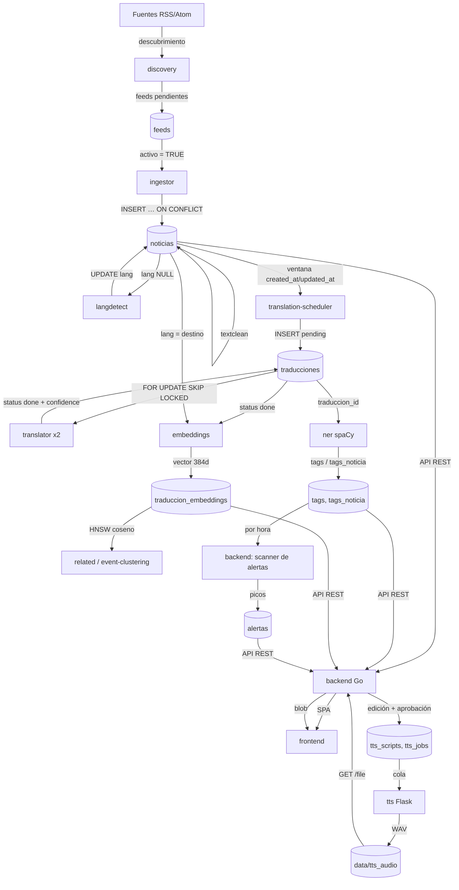
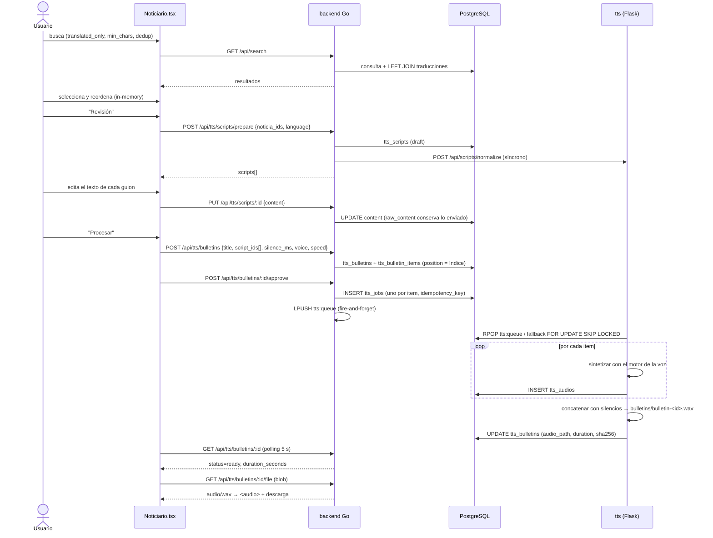

# RSS2 — Flujo de Datos

> Recorrido de los datos desde el descubrimiento de una fuente hasta la presentación y el audio.
> Verificado el **2026-10-26**. Fuentes: `[CÓDIGO]`, `[DB]`, `[DOC]`, `[HIPÓTESIS]`.

---

## 1. Mapa general



---

## 2. Etapa por etapa

### Etapa 0 — Descubrimiento y administración de fuentes

| Entrada | Proceso | Almacén | Fallo |
|---|---|---|---|
| `fuentes_url` (páginas candidatas) | `discovery` (Go) sondea cada 15 min, busca enlaces RSS/Atom, propone feeds | `feeds` (`activo`, `fallos`, `last_check`, `is_healthy`) | Circuit-breaker por dominio (30 min); auto-desactivación a los 5 fallos; auto-reactivación a las 24 h |

- `findFeedLinksInHTML` es un **stub que devuelve lista vacía** → la detección de enlaces en HTML
  **no está implementada**; el worker sólo puede confirmar feeds ya conocidos. `[CÓDIGO: cmd/discovery/main.go:375-379]`
- La interfaz web (`/feeds`) permite alta manual, importación CSV, exportación CSV, marcado
  `traducido` (individual y masivo), desactivación, reactivación y borrado masivo.

**Borrado masivo — protección en servidor:** `POST /api/feeds/bulk-delete` responde **428** con la
previsualización (`feeds_affected`, `noticias_affected`) salvo que el cuerpo incluya
`confirmar: true`. El borrado en cascada elimina `noticias` → `traducciones` → `tags` → embeddings →
clusters vía el FK `noticias.feed_id`. `[CÓDIGO: handlers/feed.go:334-398]`

### Etapa 1 — Consulta de feeds y extracción de artículos

`ingestor` (Go, `rss-ingestor-go/main.go`).

1. `getActiveFeeds()` → todos los feeds con `activo = TRUE` y `fallos < 10` (**sin paginación**).
2. 20 goroutines reparten los feeds desde un canal bufferizado.
3. Por feed: GET con `If-None-Match`/`If-Modified-Since`, UA `RSS2-Ingestor-Go/1.0`,
   `politeDelay(host)` de 500 ms.
4. `gofeed` parsea RSS 2.0 / RSS 1.0 / RDF / Atom. Ítems sin `Link` se descartan.
5. Fecha: `PublishedParsed` → `UpdatedParsed` → `now()`.
6. Cuerpo: `Description` → fallback `Content`.
7. `textclean.CleanTitle` / `textclean.Clean` (HTML real parseado con `x/net/html`).
8. Imagen: `item.Image` → `Enclosure` de tipo `image/*` → `media:content` → `media:thumbnail` →
   primer `` del HTML.

**Si falla:** se incrementa `feeds.fallos` y se guarda `last_error`; a 10 fallos el feed se
desactiva. No hay reintento dentro del ciclo ni backoff exponencial: el siguiente tick lo reintenta.

### Etapa 2 — Normalización y deduplicación

```
https://www.x.com/a/?utm_source=rss&id=7  ──normalizeURL──▶  x.com/a?id=7
http://x.com/a                            ──normalizeURL──▶  x.com/a
                                             generateID  ──▶  md5("x.com/a")
```

`normalizeURL` (main.go:240-274): sin esquema → host en minúsculas → sin `www.` → sin puerto
implícito (`:80`/`:443`) → `EscapedPath()` sin barra final → se eliminan los parámetros de tracking
conocidos (`fbclid`, `gclid`, `utm_*`, `ref`, `source`, `spm`, …) → query restante re-codificado con
`q.Encode()` (ordenado). `generateID` = `md5` hexadecimal (32 caracteres = `noticias.id VARCHAR(32)`).

**Deduplicación en dos capas:**
1. El id es direccionable por contenido → la misma URL con variantes colapsa sola.
2. `ON CONFLICT DO NOTHING` en el INSERT → nunca se duplica la misma clave primaria.

**Lo que NO se deduplica:** el mismo artículo publicado por dos fuentes con **URLs distintas**
produce dos noticias. `make dedupe-noticias` (migración 63) agrupa por (feed, URL normalizada) —
**nunca por título** (24.275 filas agrupadas por título frente a 1.098 duplicados reales). `[DOC: AGENTS.md]`

### Etapa 3 — Persistencia del texto original

`noticias` almacena:
- `titulo`, `resumen` → **texto limpio**.
- `titulo_raw`, `resumen_raw` → **el original**, escrito sólo la primera vez (`COALESCE(titulo_raw, $3)`).
- `cleaned_at` → marca de passage por `textclean`.

El comando `sanitize` (una pasada, no un worker) aplica el limpiado, guarda el original y opcionalmente
re-encola las traducciones (`status='pending'`, campos traducidos a NULL, `DELETE` de embeddings y
`tags_noticia`, `noticias.lang = NULL`). Es **idempotente**: sólo procesa `cleaned_at IS NULL`.
`-restore` deshace desde `*_raw`. `[CÓDIGO: cmd/sanitize/main.go]`

> Estado real: 817.301 de 814.290 filas tienen `cleaned_at IS NULL` → **la mayoría del corpus no ha
> pasado por `textclean`** (el ingestor limpia en línea, pero estas filas son anteriores al reset o
> proceden del scraper). 668 filas tienen `contenido` no vacío (lo rellena el `scraper`). `[DB]`

### Etapa 4 — Detección de idioma

`langdetect` (Python) → `noticias.lang`.

- Selecciona `WHERE lang IS NULL OR TRIM(lang) = ''`, `ORDER BY fecha DESC LIMIT 1000`.
- Detecta sobre `titulo + " " + resumen`; `langdetect.detect`; devuelve `None` si <10 caracteres.
- **Reordena por `id` ascendente antes de escribir** para no hacer deadlock con `topics`
  (que hace un UPDATE masivo de la misma tabla). `[CÓDIGO: workers/langdetect_worker.py:65]`
- Un UPDATE por fila, un COMMIT por lote.
- Dormir 60 s si el lote vino vacío; 1 s si hubo trabajo.

**Excepción importante:** los feeds marcados `feeds.traducido` se insertan con `lang = TARGET_LANGS[0]`
directamente desde el ingestor → `langdetect` los ignora y el scheduler tampoco los traduce.
`feeds.traducido` es una **lista curada a mano** (5 feeds hoy), distinta de `feeds.idioma` (metadato
declarado por el canal, a menudo incorrecto). `[DOC: AGENTS.md]`

**Estado real:** 294.796 filas con `lang IS NULL` (≈36 % del corpus) — la cola de `langdetect` es
enorme y crece con la ingesta. `[DB]`

### Etapa 5 — Traducción

```
noticias (lang conocido, ≠ destino)
        │  translation-scheduler: NOT EXISTS + ventana temporal
        ▼
traducciones (status='pending', lang_from, lang_to)
        │  translator: FOR UPDATE SKIP LOCKED
        ▼
traducciones (status='done', titulo_trad, resumen_trad, contenido_trad, confidence)
```

- **Creación del trabajo**: `NOT EXISTS (traducciones para ese lang_to)` + `ON CONFLICT DO NOTHING`.
  Idempotente. Se escribe también `traducciones_target` (pivote "traducción solicitada").
- **Elección del trabajo**: el traductor ordena por `n.fecha DESC` → **prioriza lo más reciente**
  independientemente del backlog.
- **Caché**: `tr:{from}:{to}:{md5(texto)}` en Redis, TTL 30 días.
- **Mismo idioma**: se copia el original y se marca `done` con `confidence = 1.0`.
- **Reintentos**: `retry_count < 3` → `pending`; ≥3 → `error`.

**Si falla el motor:** el lote se devuelve a `pending` con `retry_count+1`; a la 4ª vez queda en
`error` (estado terminal, **no reintentado**).

> **Estado real:** 453.724 filas, **26.524 `done`** (5,8 %), **427.200 `pending`**. La cadencia
> medida es de ~15–17 noticias/min por traductor (`translation_stats`: lotes de 128 entre 455 s y
> 1.214 s) → **~31/min con dos traductores**. La ingesta reciente es de 174.727/día (día parcial)
> a 635.681/día (2026-10-25) → **142 a 440/min**. El backlog crece entre 4× y 14× más rápido de lo
> que se drena. `[DB]` — ver `KNOWN_ISSUES.md` ISS-001.

### Etapa 6 — Extracción de entidades

`ner` (Python/spaCy) consume **traducciones** `done`, no noticias originales.

- Anti-join con `tags_noticia` → cada traducción se procesa **una sola vez**.
- Entidades por tipo; temas = `noun_chunks` (≤15 por documento), en minúsculas y sin artículo inicial.
- Filtros: blocklist de BD + `entity_config.json` + reglas de forma (URLs, atributos HTML, palabras
  genéricas, tokens pegados).
- Si no hay nada: se inserta el centinela `_none_` (tipo `sistema`) para no reprocesar.
- COMMIT **por noticia** (no por lote) → se pierde poco trabajo si falla una fila.

**Relación con las alertas:** el detector de picos **no** lee una tabla de menciones; agrega
`tags_noticia ⋈ tags ⋈ traducciones ⋈ noticias` por hora. Por eso necesita que NER haya procesado
al menos la traducción.

### Etapa 7 — Embeddings

`embeddings` (Python) → `traduccion_embeddings` (384 dims, modelo `paraphrase-multilingual-MiniLM-L12-v2`).

**Dos rutas** (migración 60):

| Ruta | Selección | `traduccion_id` | `noticia_id` |
|---|---|---|---|
| Traducciones | `traducciones.status='done'` ∧ `lang_to = ANY(EMB_LANGS)` ∧ sin embedding | NOT NULL | NULL |
| Originales en español | `noticias.lang = ANY(EMB_LANGS)` ∧ texto no vacío ∧ `created_at > cursor` ∧ sin embedding | **NULL** | NOT NULL |

- Escritura con `execute_values` + `ON CONFLICT DO UPDATE`, y una **segunda pasada** que escribe la
  columna `embedding_vector` con un UPDATE por fila (N idas y vueltas).
- **Cursor** sobre `created_at` (el id es un md5, no ordenable). Cuando el lote vuelve vacío el cursor
  se reinicia a `None` → en reposo se re-recorre la tabla desde el principio cada 5 s.
- `ensure_schema()` del worker declara `traduccion_id INT NOT NULL`, **contradiciendo** la
  migración 60 (nullable). Inofensivo hoy porque la tabla ya existe, pero rompería una base nueva.
  `[CÓDIGO: workers/embeddings_worker.py:77]`

### Etapa 8 — Recuperación vectorial y agrupamiento

| Consumidor | Query | Salida |
|---|---|---|
| `related` (Go) | vecinos por coseno vía la función `find_related_translations(vector(384), …)` + HNSW | `related_noticias` |
| `event-clustering` (Go) | similitud ≥ `CLUSTERING_MIN_SIM` (0,85) **y** ≥2 entidades compartidas, ventana 72 h | `event_clusters`, `noticia_clusters` |
| `backend` (Go) | búsqueda semántica: 2 ramas con `UNION` (traducciones `done` **y** originales en español) | `/api/search?semantic=true` |

**Regla de parámetros posicionales (verificada):** el idioma destino es **siempre `$1`**; los
filtros van después; `LIMIT`/`OFFSET` son los dos últimos. El bug histórico era calcular el
placeholder como `len(extraArgs)+1`. `[CÓDIGO: backend/internal/services/ml.go:252-293]`

El vector se incrusta en el SQL como literal de texto `'…'::vector` (float con `%f`).

### Etapa 9 — Alertas

El backend escanea cada `ALERTS_SCAN_INTERVAL_MIN` (compose: 15). Ver `ARCHITECTURE.md` §8.

- Bucket: `date_trunc('hour', n.fecha)`; hora de referencia = la **última hora con noticias etiquetadas**.
- Baseline ponderado por volumen (fórmula en `ARCHITECTURE.md` §8.1).
- Se escribe en `alertas` con `ON CONFLICT (valor, tipo, periodo) DO NOTHING`.
- Filtros en Go: blocklist, `entitycheck.Classify` (falsos positivos, incluidos los "débiles"),
  cooldown de 6 h.
- **Fallo:** el scan tiene contexto de 3 minutos; si se agota, se aborta y se reintenta en el ciclo
  siguiente. `alertas` es estado agregado → no se reconstruye desde `noticias`.

### Etapa 10 — Búsqueda y presentación

`GET /api/search` (`handlers/search.go:147`) es el endpoint más usado:

- **Requiere** al menos un criterio (`q`, `categoria_id`, `pais_id`, `lang`); si no, 400.
- Filtros: `desde`/`hasta` (relativo `24h`/`7d`/`90m` o ISO), `min_chars` (medido sobre el texto
  **narrable**: `COALESCE(contenido_trad, contenido, resumen_trad, resumen)`), `dedup=cluster`
  (anti-join con `noticia_clusters`), `topic_id`, `orden=relevancia` (`ts_rank`).
- Cota dura `n.fecha <= NOW() + INTERVAL '1 day'` para excluir ~400 filas con fechas del año 3000.
- **`translated_only`** = `(t.status='done' AND t.titulo_trad IS NOT NULL AND t.titulo_trad != n.titulo) OR n.lang = <destino>`.
  El `JOIN` con `traducciones` **debe ser `LEFT`**: con `INNER` la rama `n.lang` es inalcanzable y
  desaparecen justo las noticias que ya están en español y son narrables. `[DOC: AGENTS.md]`
- `total` se cuenta con **el mismo WHERE** y **en todas las páginas** (no sólo la 1).
- Caché Redis 5 min, clave con todos los filtros.

`GET /api/news` (`handlers/news.go:292`): si hay cualquier filtro, cuenta con `COUNT(*)` y el mismo
WHERE; sin filtros usa `reltuples` de `pg_class` como aproximación global.

### Etapa 11 — Enriquecimiento externo

| Worker | Fuente | Notas |
|---|---|---|
| `wiki` | Wikipedia REST + OpenSearch | Sólo entidades `persona`/`organizacion`; guarda resumen, URL y miniatura; rechaza desambiguaciones |
| `scraper` | `fuentes_url` (HTML) | Extrae `og:title`/`og:description`/`og:image` y contenido principal; rellena `noticias.contenido`; **usa `md5(url)` sin `normalizeURL`** → puede divergir del id del ingestor |
| `discovery` | HTML de `fuentes_url` | Busca feeds candidatos (parcialmente implementado) |

Caché de Wikipedia en Redis: `wiki:summary:<lang>:<title>`, TTL 48 h.

### Etapa 12 — Noticiario (selección → Parrilla → edición)

Detalle completo en §3.

### Etapa 13 — Generación de audio

Detalle completo en §4.

---

## 3. El noticiario en detalle



### 3.1 Selección de noticias

Dos modos en la UI (`Noticiario.tsx`):

| Modo | Origen | Parámetros |
|---|---|---|
| `busqueda` | `GET /api/search` | `q` (obligatorio), `lang=es`, `desde=7d`, `orden=reciente`, `min_chars=150`, `dedup=cluster`, `translated_only=true` |
| `tendencias` | `GET /api/tts/trends` | `dias=2`, `limite=40` |

También se puede cargar una lista guardada (`GET /api/lists/:id/items`) en la selección.

**Los chips de "temas en tendencia" son inertes**: son `<span>` sin `onClick` → no se puede filtrar por
tema. Y el parámetro `topic_id` (que el backend sí soporta) **nunca se envía** desde la UI. `[CÓDIGO]`

### 3.2 La parrilla y su orden

- El estado es `const [selected, setSelected] = useState<News[]>([])` → **sólo en memoria**.
- El orden se comunica al backend **implícitamente** por el orden del array `script_ids` de
  `POST /api/tts/bulletins`; el backend asigna `position = índice + 1`.
- **No hay persistencia**: recargar la página pierde la selección **y su orden**.
  No existe `localStorage` para ello ni endpoint de "borrador de parrilla".
- Reordenar = botones ▲/▼ (no hay *drag & drop*).

### 3.3 Edición de los textos

- `POST /api/tts/scripts/prepare` crea (o reutiliza) un borrador por noticia y **delega la
  normalización** al servicio TTS (`/api/scripts/normalize`): números, fechas, abreviaturas,
  porcentajes, moneda, ordinales, URLs.
- El usuario edita `content` en un `<textarea>`; `PUT /api/tts/scripts/:id` **re-normaliza** y
  guarda el texto enviado en `raw_content`. Sólo los borradores son editables (409 si no).
- **No existe ningún campo de notas/comentarios personales**: ni en la tabla `tts_scripts`, ni en los
  tipos de TypeScript, ni en el payload de la API. La única libertad editorial es **reescribir el
  texto que se va a locutar**. `[CÓDIGO: init-db/57-add-tts.sql:44-65]`
- **Bug confirmado**: `processBulletin` reutiliza el array `scripts` si no está vacío; si el usuario
  abre la revisión, la cierra y luego añade o quita noticias, se envían los **guiones antiguos** →
  las noticias nuevas se pierden en silencio, y reordenar la parrilla tampoco cambia el resultado.
  `[CÓDIGO: frontend/src/pages/Noticiario.tsx:441-485]`

### 3.4 Duración estimada

`CHARS_PER_SECOND = 16,6` (medido: 2.774 caracteres → 167 s a velocidad 1,0).

```
estimatedSeconds = Σ (chars_i / (16,6 × speed)) + (n-1) × (silence_ms/1000)
```

Calculado sobre el **cuerpo de la noticia**, no sobre el guion que se locutará (que sólo se conoce
tras la revisión y puede estar truncado/normalizado) → la estimación puede desviarse. La duración
**real** la mide el motor (`probe_audio` → `frames/samplerate`) y se guarda en `tts_audios`. `[CÓDIGO]`

---

## 4. Generación de audio en detalle

### 4.1 Asíncrono (camino de producción)

1. `POST /api/tts/jobs` → el backend exige que el guion esté `approved`, resuelve la voz (por `slug`,
   por defecto `es-base`) y el motor (petición → voz → `TTS_ENGINE` global), calcula
   `idempotency_key = sha256("script:%d|voice:%s|engine:%s|speed:%.2f")`, inserta en `tts_jobs` con
   `ON CONFLICT DO NOTHING` y hace `LPUSH tts:queue`.
2. El worker Python hace `RPOP tts:queue`; si Redis está caído usa
   `claim_next_job` (`FOR UPDATE SKIP LOCKED` sobre Postgres).
3. `_process_job`: valida (guion existe, aprobado, voz existe, texto no vacío) → sintetiza a un
   temporal → valida el audio → lo mueve a `<audio_dir>/<script_id>/job-<job_id>.wav` →
   `INSERT tts_audios` → `mark_job_succeeded`.
4. `_maybe_build_bulletins` ensambla los boletines pendientes cuyas piezas ya están listas.

### 4.2 Estados y errores

| Situación | Código | Reintentable |
|---|---|---|
| Pesos ausentes | `engine_not_prepared` | no |
| Fallo al cargar el modelo | `engine_load_failed` | **sí** |
| Excepción del motor | `synthesis_failed` | **sí** |
| Motor desconocido | `unknown_engine` | no |
| Texto vacío | `empty_text` | no |
| Voz sin referencia ni embedding | `voice_without_reference` | no |
| Embedding `.pth` pedido a Chatterbox | `voice_embedding_unsupported` | no |
| Idioma no soportado por Chatterbox | `language_unsupported` | no |
| Audio inválido / ilegible / vacío | `audio_invalid`, `audio_unreadable`, `audio_empty` | no |
| Excepción no prevista | `unexpected_error` | **no** |

- Reintento sólo si `exc.retryable AND attempts < max_attempts` (`max_attempts` viene de la fila del
  trabajo; por defecto 2).
- **Watchdog** (cada 30 s): si el trabajo lleva más de
  `max(job_timeout, (chars/16,6) × 3)` → `failed` con `timeout`; si no, se reencola con
  `stale_recovered`. Es lo que evita que un trabajo quede bloqueado tras un reinicio.

### 4.3 Almacenamiento y servicio del audio

| Aspecto | Valor |
|---|---|
| Ruta en el contenedor | `/app/data/tts_audio` (`TTS_AUDIO_DIR`) |
| Ruta en el host | `./data/tts_audio` (rw en `tts`, **ro** en `backend`) |
| Pieza | `<audio_dir>/<script_id>/job-<job_id>.wav` |
| Boletín | `<audio_dir>/bulletins/bulletin-<bulletin_id>.wav` |
| Formato | WAV PCM_16 (Chatterbox 24 kHz; MeloTTS/OpenVoice ~22,05 kHz) |
| Metadatos en BD | `storage_path` (relativa), `duration_seconds`, `sample_rate`, `size_bytes`, `sha256`, `engine`, `engine_version`, `parameters` JSONB |
| Servido por | `GET /api/tts/audios/:id/file` y `GET /api/tts/bulletins/:id/file` (JWT obligatorio) |
| Path traversal | Bloqueado por `resolveTTSAudioPath` (rechaza rutas absolutas y escapes del directorio base). Hay test unitario, incluido el caso del symlink. `[CÓDIGO: handlers/tts.go:2104-2124]` |

### 4.4 Ensamblado del boletín

- `concatenate_wavs` procesa **en bloques** (44.100 frames) — no carga el boletín entero en memoria.
- La frecuencia de muestreo se toma del **primer** item; los items con otra frecuencia se re-muestrean
  con `librosa.resample`.
- Silencio de `silence_ms` (por defecto 800 ms, clamp 0–10.000) **entre** items, no después del último.
- Se escribe el manifiesto en `tts_bulletin_items` (`position`, `start_offset`, `duration_seconds`,
  `audio_id`) → el audio puede mapearse sobre las noticias de origen.
- Estados: `pending` → `ready` → `approved` | `rejected`; `failed` si falla el ensamblado.
- Máximo **50 items** por boletín.

### 4.5 Rendimiento medido del TTS

El log del worker del 2026-10-26:

```
Procesando tarea TTS 6 (script=6, motor=chatterbox)
... Sampling 443/1000 steps ...
Tarea TTS 6 completada en 327.1s (audio 6, 17.6s de audio)
Noticiario 1 montado: 6 noticias, 138.0s de audio
```

**Factor de tiempo real ≈ 18,6×** (327 s de cómputo para 17,6 s de audio) con Chatterbox en CPU
(4 cores saturados, `OMP_NUM_THREADS=2`). Extrapolando: el boletín de 138 s de audio costó
**~33 minutos** de reloj. Ver `KNOWN_ISSUES.md` ISS-002. `[DB] docker compose logs tts]`

---

## 5. Resumen de puntos de fallo

| Etapa | Si falla | Recuperación | ¿Pierde datos? |
|---|---|---|---|
| Ingesta (un feed) | `fallos++`; a los 10, se desactiva | Reintento en el siguiente ciclo | No |
| Ingesta (batch insert) | Se salta el lote; se registra | Reintento en el siguiente ciclo | **Sí, los artículos de ese lote no se recuperan** (no hay cola) |
| Ingesta (feed borrado) | Detecta SQLSTATE 23503 y lo reporta | — | No |
| `langdetect` | Log + 10 s de espera | Reintenta; `lang` sigue NULL | No |
| Scheduler | Log; el ciclo sigue | Reintenta en 30 s | No |
| Traductor | `retry_count+1`; a 3 → `error` | Manual | **Sí: `status='error'` es terminal** |
| NER | COMMIT por noticia | Reintenta (anti-join) | No |
| Embeddings | Log; el cursor se mantiene | Reintenta | No |
| TTS (motor) | Reintento si `retryable` | Watchdog a los 30 s | No |
| TTS (ensamblado) | Boletín `failed` | Manual | Sí (el audio no se genera) |
| Redis | **fail-open**: se sirve de Postgres | Automático | No |
| Postgres | Todo se detiene | Los contenedores reintentan (`restart: unless-stopped`) | No, si el volumen persiste |

**Conclusión operativa:** el único punto de pérdida de datos real es el **batch insert del ingestor**
(no hay cola de reintento) y el estado `error` del traductor (terminal, sin re-encolado automático).
